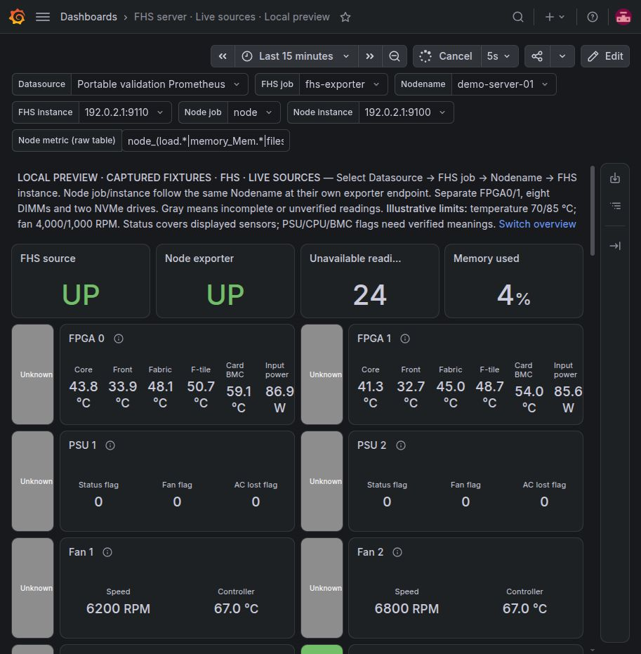
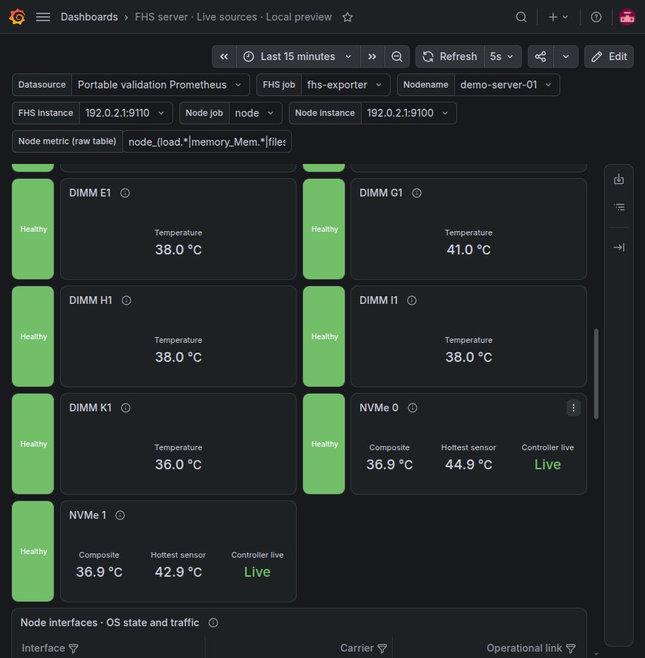
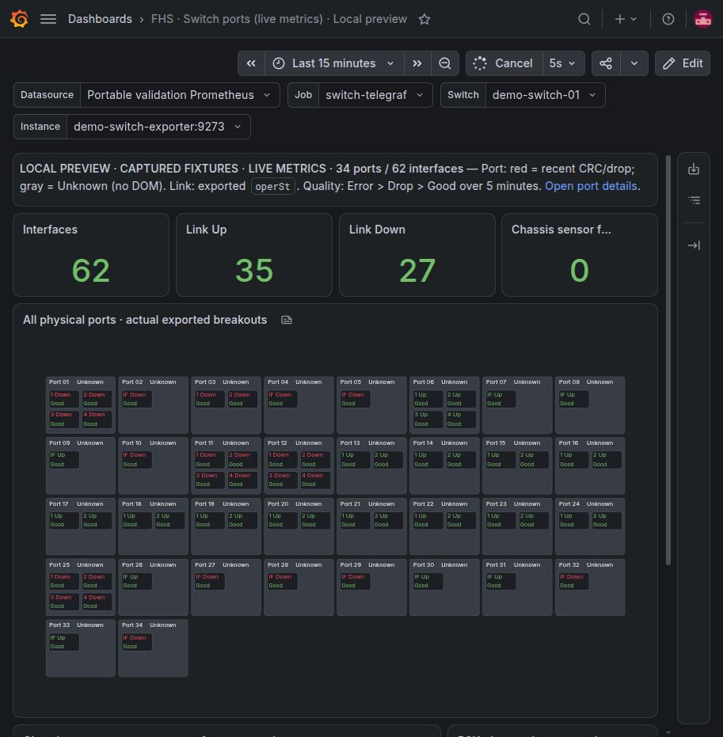
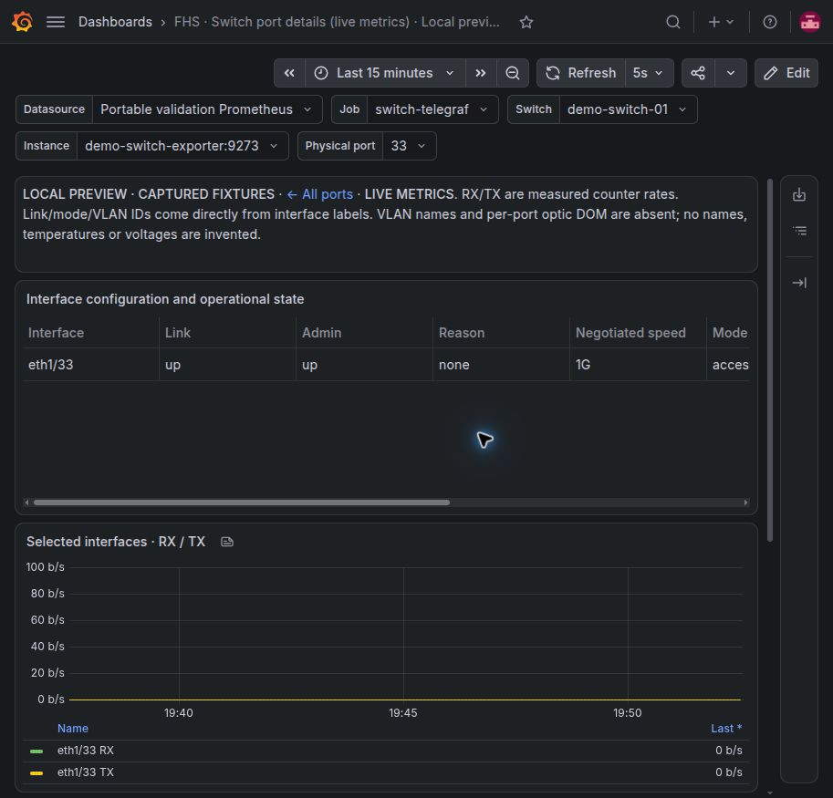

# Verification — 2026-10-20

The independent Docker CLI lab was launched with Grafana 13.2.4 on loopback port
3003 and Prometheus on loopback port 9093. Existing prototype instances on
3001/3002 were kept running. The FHS bare-metal repository was only fast-forwarded
to development `6569833` to read the three supplied exports; no provisioning or
exporter deployment was run there.

## Initial replay checks (before portable import correction)

- **24 Python tests passed**, including the optional original-export parity and
  live integration tests. The seven source checks cover numeric/timestamp/schema
  parity, fixture hashes/cardinality, escaped label exposition, nonfinite values,
  invalid/duplicate samples and HTTP responses from all three sources.
- All **79 replay dashboard queries** execute successfully against Prometheus:
  63 FHS queries and 16 switch overview/detail queries. The sibling implementations
  also checked their live-source variants against the captured real job labels.
- Actual Promtool health acceptance suites pass. FHS covers complete healthy and
  degraded readings, partial coverage, absent readings, unavailable scrape,
  observed-failure precedence, unverified flags and DIMM completeness. Switch
  injects recent CRC/drop increments, error precedence, historical counters,
  up/down/unknown links, parent aggregation and stopped-source unknown fallback.
- Promtool validates the running Prometheus configuration. All three real replay
  scrape targets report UP. Scraped captured-series counts equal 103, 9,989 and
  8,641; replay-generated scrape metrics remain under separate `replay-*` jobs.
- Compose YAML, all bind-mount source paths, image digests and Python syntax
  validate. The Compose plugin is unavailable on this host, so Compose itself was
  not executed; `python3 run.py` is the verified launcher.

## Browser checks

Native Grafana was inspected in Chrome at its normal 913 × 931 viewport.

- [FHS overview](screenshots/fhs-overview.jpg): actual temperatures, card power,
  flag values and fan RPM are visible beside status tiles. Missing/partial or
  unverified data shows Unknown. The baseline has three Healthy component groups
  and nine Unknown groups under the stated conservative policy.
- [Switch overview](screenshots/switch-overview.jpg): all 34 parent ports and 62
  actual interfaces fit in one field. The snapshot contains 35 links Up and 27
  Down. Background elements do not render edit placeholders; Canvas fit requires
  the enabled `canvasPanelPanZoom` feature.
- [Switch detail](screenshots/switch-detail.jpg): clicking Port 01 opens exactly
  its four child interfaces with exported mode, VLAN IDs, reason, RX/TX rates,
  lifetime CRC and recent error/drop histories. Its historical CRC count of one
  does not create a recent Error. The dropdown was then used to select Port 33;
  it showed `eth1/33`, Up, access mode and the supplied VLAN ID.

## Limits before operational use

The test sources freeze one captured value per series; zero replay traffic rates
are not an observation of present hardware traffic. Scrape timestamps describe
the lab's current scrape, not original device freshness. Metric-type metadata was
not included in the exports. Per-port optical DOM and VLAN names are absent.
FHS flag encoding and equipment-specific temperature/fan limits still require
confirmation; the dashboard makes those gaps visible. Switch geometry is generated
from the supplied interface layout and must be regenerated for another topology.
Production deployment and physical-device fault injection were not performed.

## Portable import correction — 2026-10-20

The user supplied a production screenshot with the explicit error **Datasource
export-backed-prometheus was not found**, and a working Node Exporter dashboard
using Datasource, Job, Nodename and Instance selectors. The previous replay JSON
was not a portable production import. The corrected [live imports](live-import/README.md)
use `${ds}` on all panels/query variables, discover jobs and endpoints, and use
actual selected-source `up` metrics without replay jobs. FHS selects each
exporter's endpoint separately through the common `node_name` label. Switch
links preserve selection and the Grafana deployment subpath.

The FHS view now names FPGA 0/1, displays all eight DIMM slots separately, adds
NVMe 0/1 controller/thermal cards and I/O histories, and uses the NIC coverage
gauges present in the supplied capture. It has 21 component cards. Interfaces
are discovered from the selected Node Exporter endpoint; the supplied sample
contains three non-loopback OS interfaces, which does not establish the seven
or eight physical ports expected by the user. No FPGA/BMC port mapping is
invented. Status describes sensor checks, not full hardware diagnostics.

Executed verification:

- 27 Python tests passed; one optional private-original parity test was skipped.
- All 206 panel queries execute against the existing local Prometheus lab:
  87 FHS and 16 switch queries in each of the replay/live variants.
- Every live FHS query returns data for the selected sample endpoints. The live
  switch returns 62 interfaces, 35 Up and 27 Down. Every query-variable chain
  resolves against the selected labels without saved demo defaults.
- Promtool passes 20 FHS cases, including custom jobs, isolation of another
  endpoint's UP/hot reading, separate DIMM failures/missing readings, and NVMe
  non-live/missing controllers. The existing switch health suite also passes.
- Static checks verify generated-file parity, no component/table overlap,
  datasource variable binding and switch link selection preservation.
- Browser verification used the existing authenticated `localhost:3003` lab
  session; the earlier password-prompt block no longer applies. No password was
  changed or prompt bypassed. The datasource dropdown was changed to a second
  UID, `portable-validation`, and both sources remained UP with real readings.
- FHS rendering showed separate FPGA temperatures/power, NIC coverage, individual
  DIMM temperatures, both NVMe controllers Live with temperatures, and three OS
  interface rows. Gray status tiles remain intentional for incomplete sensor
  coverage or unverified flags; they no longer hide a datasource/query error.
- Switch rendering showed 62 interfaces, 35 Up, 27 Down, and populated Canvas
  fields. Clicking the Canvas Port 33 link opened `eth1/33`, Up, access mode,
  VLAN 289, while retaining datasource, job, instance and switch selections.
  The return link reached the populated overview with the same selections.
- Browser checks caught explicit regex interpolation producing invalid IP-address
  escapes, stripped bare `d/` Markdown links, and incorrect relative SPA
  navigation. Named selectors now use the Prometheus datasource's default
  interpolation. Links use `./d/` relative to Grafana's base URL and open a new
  tab for a complete browser navigation. Subpath resolution follows that base;
  a deployed reverse-proxy instance was not exercised.

Corrected local previews are explicitly bannered **CAPTURED FIXTURES**; they prove
rendering/integration, not a connection to current physical equipment. Production
was not modified. The rack elevation prototype still requires real rack metadata
and aggregate health integration.

